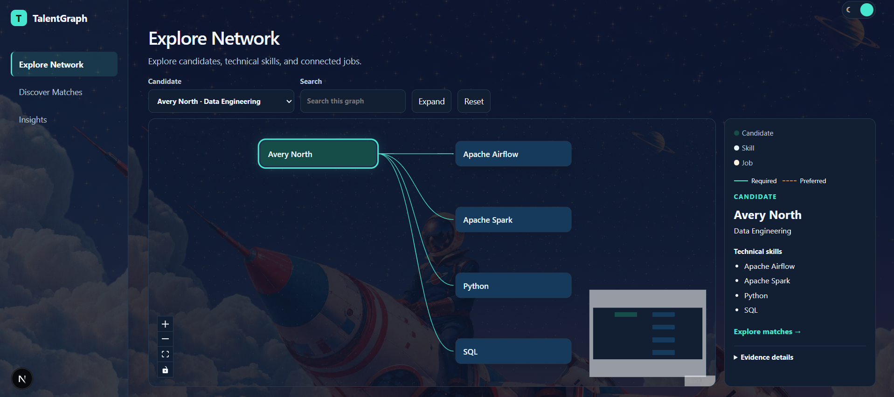
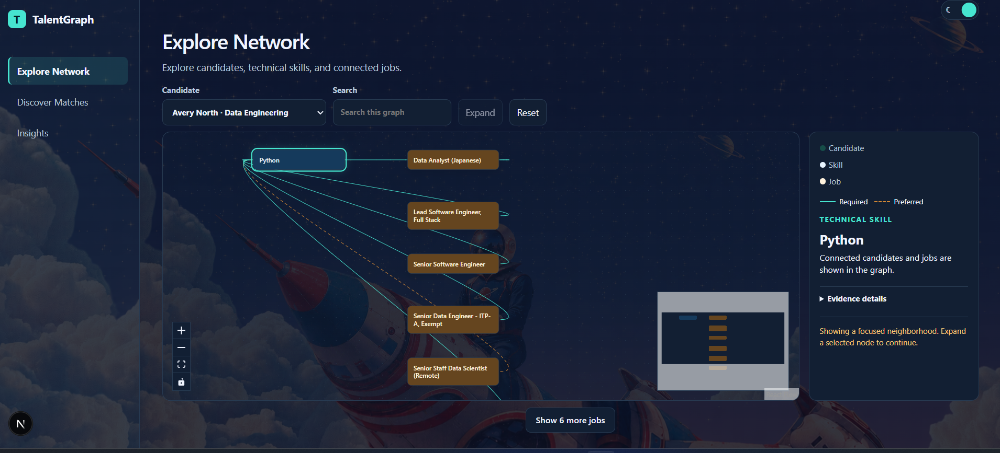
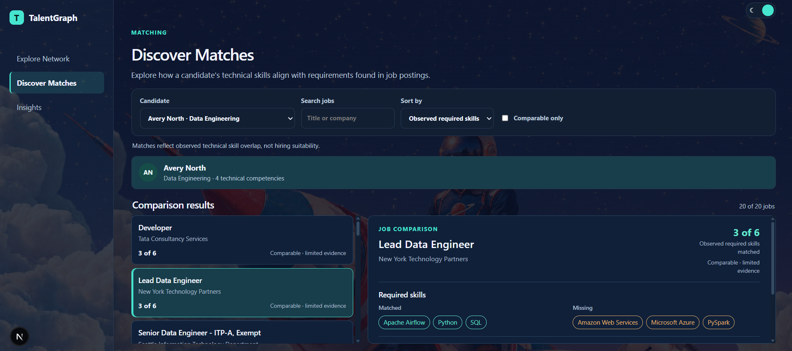
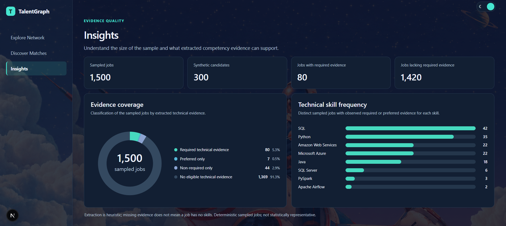

# TalentGraph

TalentGraph is a local talent intelligence and workforce analytics prototype. It connects a deterministic sample of 1,500 public job postings with technical competencies and 300 fictional candidate profiles to explore job-skill relationships and visible skill gaps.

Python and local PySpark prepare curated Parquet; DuckDB holds analytical job, company, location, and taxonomy tables. Separate classified-evidence and candidate artifacts feed NetworkX relationships and evidence-aware comparisons through a read-only FastAPI backend and Next.js frontend. Match results describe observed overlap with extracted required competencies only. They do not predict hiring outcomes or determine suitability.

## Run locally

Use Python 3.12 and the pinned packages in [`requirements.txt`](requirements.txt). The existing backend pins are included through [`requirements-backend.txt`](requirements-backend.txt). To prepare an approved Python 3.12 environment, install those pins with `python -m pip install -r requirements.txt`. The frontend uses its own [`package-lock.json`](frontend/package-lock.json). The commands below assume the existing local virtual environment, Node toolchain, production DuckDB, and ignored processed artifacts; they do not acquire or rebuild data.

Start the read-only backend from the repository root:

```bash
PYTHONPATH=src /home/developer/venvs/talentgraph/bin/uvicorn talentgraph.api:app --app-dir src
```

In another shell, activate the repository-local Node.js installation and start Next.js:

```bash
export PATH="$PWD/.tools/node-v22.14.0-linux-x64/bin:$PATH"
cd frontend
npm ci
npm run dev
```

The frontend proxies `/backend/*` to FastAPI on port 8000.

Run Python regression checks from the repository root with `PYTHONPATH=src /home/developer/venvs/talentgraph/bin/python -m unittest discover -s tests`. Spark tests may need a WSL session that permits Java sockets. In `frontend/`, `npm run typecheck` and `npm run lint` check the UI. Do not run `next build` alongside a development server sharing `.next`.

## Application destinations

- `/network` — Explore a bounded candidate-to-skill-to-job React Flow neighborhood. Select candidates or nodes, search the loaded neighborhood, expand to a second hop, inspect evidence details, and open matches for the selected candidate.
- `/matches` — Select a demonstration candidate and compare jobs in a split view. Search by title/company, sort by observed overlap or required-skill count, filter to comparable jobs, and inspect matched, missing, preferred, and provenance details.
- `/insights` — View sample KPIs, mutually exclusive evidence-coverage groups, and distinct-job frequencies for observed required or preferred technical skills.

The selector is intentionally a compact demonstration view over the full 300-record synthetic dataset; records are not deleted or regenerated by the UI.

## Application screenshots

Captured from the local application on October 13, 2026, in dark mode. Click an image to view it at full size. The **N** badge visible in the lower-left corner is the Next.js development indicator.

| Explore Network: candidate neighborhood | Explore Network: Python skill neighborhood |
|---|---|
| [](docs/screenshots/network-candidate-neighborhood.png) | [](docs/screenshots/network-python-skill-neighborhood.png) |
| **Candidate view:** a fictional candidate and four stored technical skills. | **Skill view:** a focused Python neighborhood with source-backed job relationships. |

| Discover Matches: candidate–job comparison | Insights: evidence coverage and skill frequency |
|---|---|
| [](docs/screenshots/matches-candidate-job-comparison.png) | [](docs/screenshots/insights-evidence-coverage.png) |
| **Comparison view:** observed required-skill overlap, missing skills, and evidence limits. | **Insights view:** sample totals, evidence classes, and observed job-skill frequencies. |

## Evidence and provenance

Raw inputs and extraction provenance are preserved locally. Graph requirement edges use only validated required or preferred technical evidence. The matching overlap is nullable when required evidence is insufficient and must not be interpreted as suitability, confidence, or hiring probability. The public sample is deterministic and not statistically representative; heuristic extraction has limited manual review.

The source archive is local and is not redistributed in this repository. Its observed manifest differs from the earlier dataset metadata, so the exact archive version remains unverified. Processed files and the production database are also local and ignored by Git; another developer needs approved access to compatible inputs and must verify paths before running the app. See the documents below for the pipeline and limitations.

## Documentation

- [Engineering overview](docs/PROJECT_DOCUMENTATION.md)
- [Data pipeline and validation](docs/DATA_PIPELINE.md)
- [Technology stack](docs/TECH_STACK.md)
- [Limitations and future work](docs/LIMITATIONS_AND_FUTURE_WORK.md)

Detailed milestone evidence remains in `agent/` and the focused technical notes under `docs/`.
