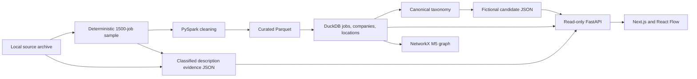

# Data pipeline

TalentGraph prepares a bounded local job sample, stores analytical models, then serves comparisons from the warehouse and two parallel JSON artifacts. Preparation is run by explicit commands; API requests do not run ingestion. The current repository has no scheduled production pipeline.

The M5 NetworkX graph reads the M4 warehouse bridge for lineage and analytical traversal. The current API builds bounded candidate-skill-job neighborhoods from candidate profiles and classified evidence; it does not treat every broad M4 bridge edge as a technical job requirement.

## Stages and checkpoints

| Stage | Input | Processing | Output | Validation |
|---|---|---|---|---|
| Source inspection and sampling | Local `data/raw/archive (2).zip`, observed `postings.csv` | Inspect ZIP safety, headers, counts, and hash; deduplicate by job ID and select lowest SHA-256 job-ID ranks. | `data/processed/job_postings_sample.csv`, `sample_metadata.json`, `rejects.csv` | Source header and archive manifest checks; selected 1,500 rows, sample metadata and deterministic selection tests. |
| PySpark transformation | Sampled CSV | Python CSV framing feeds an explicit 31-field Spark schema; normalize identifiers, timestamps, salary fields, and metadata; separate rejects. | `data/processed/m2_ingestion/job_postings/` and `rejects/` Parquet | `quality_report.json`, row/reject counts, duplicate-ID handling, schema and malformed-width tests. Final recorded sample run: 1,500 accepted, zero rejects. |
| Curated Parquet boundary | M2 DataFrames | Write deterministic sorted job facts and rejects as local Parquet. | Reusable Parquet partitions under `data/processed/m2_ingestion/` | Read-back and repeat-run tests in M2 records; descriptions and URLs are not in the curated job columns. |
| DuckDB warehouse | Curated job Parquet; archive skill mapping tables for M4 | Create company/location dimensions, job fact, analytical views, taxonomy, and source-skill bridge. | Configured production `/home/developer/talentgraph_data/talentgraph.duckdb`; repository `data/processed/talentgraph.duckdb` is a separate known file. | M3 SQL checks for fact grain, unique job IDs, joins, dates, and salary ranges; M4 bridge keys, foreign keys, and counts. |
| Technical evidence | Raw archive descriptions and accepted IDs | Rule-based detection and five-class context classification; map eligible terms to canonical skill IDs. | `data/processed/job_competency_evidence_qa_fix04.json` (`m7-evidence-v2`) | Schema/version and provenance checks, classification fixtures, deterministic artifact checks, bounded human review. |
| Fictional profiles | Read-only `dim_skill` taxonomy | Seeded role-family and seniority templates generate 300 synthetic candidates. | `data/processed/synthetic_candidates.json` (`m6-v2`) | Stable keys, allowed technical skills, seed/repeat generation, 100 junior/120 mid/80 senior distribution. |
| Relationships | M4 warehouse for M5; candidate and evidence artifacts for current UI | Build NetworkX typed relationships; project bounded verified candidate/skill/job neighborhoods for API. | In-memory graph and API response, not a persisted candidate graph table. | Graph node/edge tests and source-backed required/preferred API-edge checks. |
| Comparisons | Warehouse job metadata, candidates, classified evidence | Compare observed required technical IDs; report preferred matches separately and preserve evidence status. | M7 result objects via FastAPI | Ranking, null-insufficient, provenance, and API contract tests. |
| Serving and visualization | Fixed production database and local JSON artifacts | FastAPI loads with read-only DuckDB connections; Next.js fetches bounded routes and React Flow renders neighborhoods. | `/network`, `/matches`, `/insights` | API tests, TypeScript/ESLint, route/build checks recorded per milestone. |

## Quality and provenance

The sampling code records archive metadata and rejects malformed or missing IDs. M2 checks an explicit input header, applies an explicit Spark schema, reports rejects and duplicate removal, and derives a run ID from the sampled CSV hash. M3 models use stable keys and SQL checks for expected row counts, duplicate job keys, orphan company/location references, invalid dates, and salary ranges. M4 validates the job-skill bridge. These checks apply at their stated boundaries; they are not a universal validation framework.

Classified evidence retains source file, recorded row number, description SHA-256, extraction rule, version, class, and excerpt. The loader rejects incompatible schema/version or missing required provenance fields. Required, preferred, mentioned, negated, and ambiguous mentions remain distinct. Only eligible technical required and preferred evidence can enter the current comparison graph; non-scoring classes remain available for inspection. The QA-FIX-07 human review is small and selected, so it does not establish general extraction accuracy.

Source-row numbers need care. M1 and the evidence extractor enumerate logical CSV records from the archive. M2 assigns `monotonically_increasing_id()` after building a Spark DataFrame from the sampled CSV. Those are different numbering schemes; a direct archive-row mapping for every curated record has not been verified. Use stable job IDs and description hashes for cross-checking until that mapping is tested.

## Observed failures and recovery boundaries

| Stage | Observed issue | Root cause / finding | Resolution or mitigation | Remaining risk |
|---|---|---|---|---|
| Source framing | Initial Spark parse yielded 1,516 records and 32 apparent malformed rows. | Legacy multiline CSV quoting did not match Spark's parser behavior. | Frame the bounded sample with Python `csv.reader`, then transform with Spark. | New source formats still require contract checks. |
| Spark environment | Restricted-shell tests failed before Spark work; a separate run had Python 3.12 driver/3.14 worker mismatch. | Java socket creation was denied by the runner; worker interpreter inherited system Python. | Approved WSL tests passed; code now points driver/workers at the same virtualenv. | Restricted runners may still block Spark startup. |
| Skill meaning | Broad M4 source categories were unsuitable as technical requirements. | Taxonomy audit and description review separated occupations from competencies. | M7 filters canonical technical categories and classified evidence. | Controlled vocabulary and heuristic context still miss or misclassify terms. |
| Evidence coverage | Previous M7 artifact yielded 101 required-evidence jobs and no preferred-only group. | It used stale QA-FIX-01 output and promoted requirement-context mentions. | Rebuilt versioned QA-FIX-04 artifact with all five classes; current groups are 80/7/44/1,369. | Only a small fraction of jobs has usable required technical evidence. |
| Source traceability | Curated and evidence row numbers could appear interchangeable. | Spark and archive readers assign numbers at different boundaries. | File, job ID, hashes, and extraction metadata are retained. | Direct source-row equivalence remains unverified. |
| Database validation | Earlier M8 entries labeled `b2314da8…` as production checksum. | That SHA-256 belongs to the repository data file; configured production is `663dbe12…`. | M8-INTEGRITY-01 checked both files and five base tables read-only. | Future records should include the resolved path and command with each hash. |

The checksum difference is a path-labeling error, not evidence of corruption. Both known files have matching logical schemas and rows across the five validated base tables, but different raw bytes. Historical validation entries remain unchanged for auditability.

## Reproducibility and operation

Fixed-input SHA-256 sampling, deterministic generation, explicit schemas, artifact versions, SQL checks, and regression tests support repeatable local work. The application opens production DuckDB read-only. This does not provide continuous ingestion, automatic retries, scheduled orchestration, production monitoring, or incident recovery. Earlier M7 idempotency tests cover specific rerun behavior; they do not constitute a deployed incremental scheduler.

Use the [README](../README.md) for startup and tests. Source, transformation, warehouse, and evidence command defaults are defined in `src/talentgraph/m1_sampling.py`, `m2_ingestion.py`, `m3_modeling.py`, `m4_skill_alignment.py`, and `m7_evidence_pipeline.py`. Run those only with approved local data and explicit path verification; this documentation task did not execute them. See [limitations and future work](LIMITATIONS_AND_FUTURE_WORK.md) for outstanding engineering gaps.
